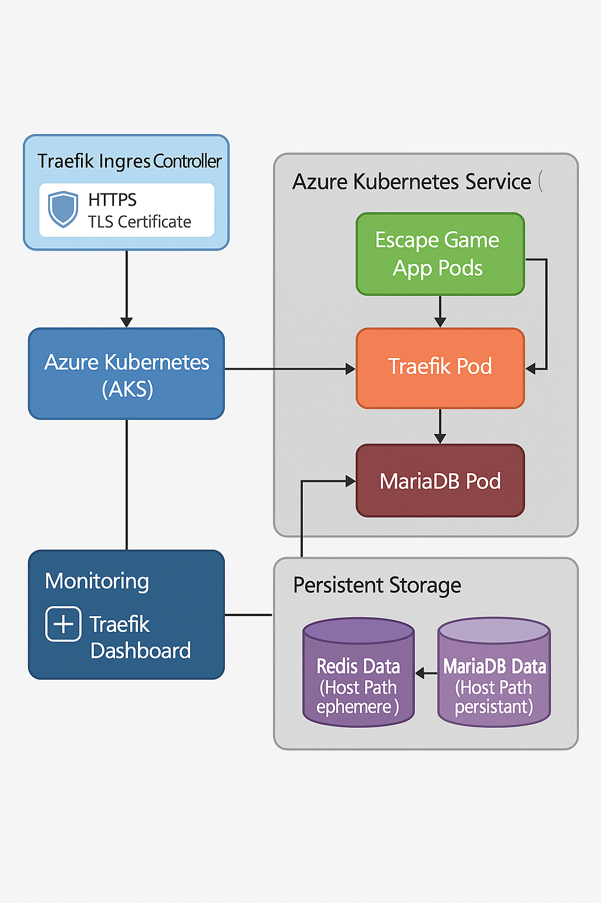
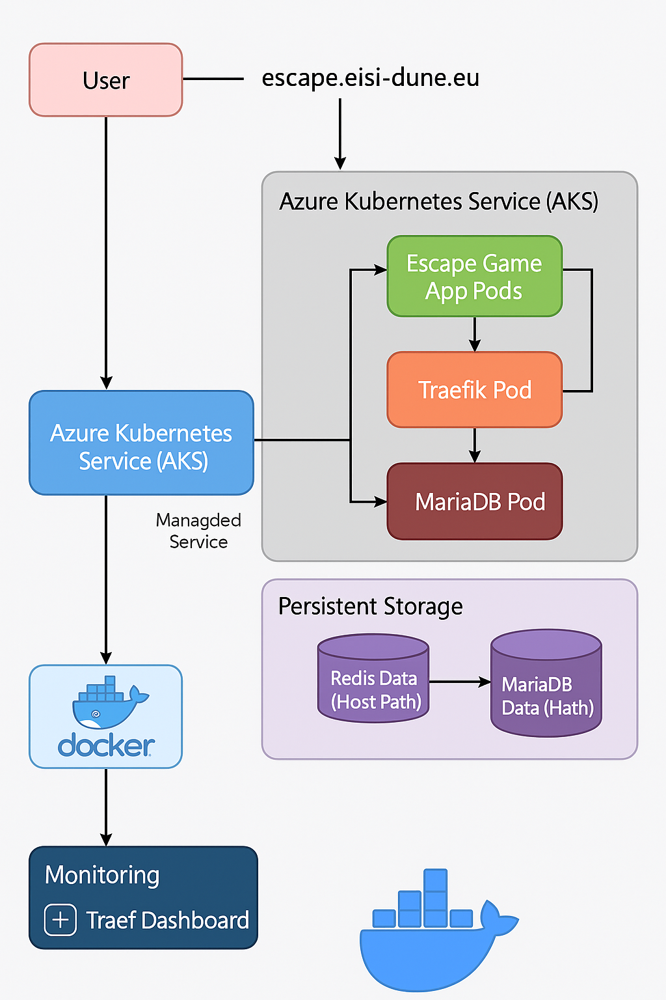

# Workshop M1 EISI 2025–2026 - Documentation

## ⚙️ Projet : **Cyber-Hôpital – Mission Résilience**

### 🎬 Concept général

Une cyberattaque a frappé un grand hôpital connecté.
Les dossiers médicaux des patients sont corrompus par un **virus informatique intelligent**.
Votre équipe (les joueurs) est une **unité spéciale de cybersécurité médicale** chargée de rétablir le système avant que les patients ne soient en danger.

🎯 **Objectif du jeu** :
Réparer les systèmes vitaux (9 salles virtuelles, débloquées l'une après l'autre) en résolvant des énigmes liées à :

* la **cybersécurité médicale**,
* la **santé humaine (données, ADN, IRM, rythme cardiaque, prothèses, pathologies, audition, vision)**,
* la **collaboration et la logique**.

---

## 🧩 Structure du jeu (Escape game numérique)

| Salle | Nom | Énigme principale | Objectif pédagogique |
| --- | --- | --- | --- |
| **1. Salle du Serveur** | “Le pare-feu corrompu” | Identifier l'encodage d'un journal d'accès (Base64), le décoder, puis répondre à la question qu'il contient | Sensibiliser à la sécurité des données de santé (encoder n'est pas chiffrer) |
| **2. Laboratoire ADN** | “Les gènes brouillés” | Reconstituer le brin d'ADN complémentaire, puis traduire un codon en acide aminé | Comprendre la logique de l'ADN et des données biomédicales |
| **3. Salle d'Imagerie** | “IRM fantôme” | Remettre dans l'ordre 4 coupes d'IRM | Découvrir le rôle de l'imagerie médicale |
| **4. Salle du Cœur** | “Arrêt cardiaque simulé” | Massage cardiaque : 30 compressions à 100-120/min, en rythme (clavier, toucher ou manette) | Connaître les gestes qui sauvent (RCP) |
| **5. Salle des Prothèses** | “Système orthopédique désynchronisé” | Calibrer la flexion du genou, puis les angles hanche / genou / cheville | Comprendre la biomécanique et les dispositifs médicaux connectés |
| **6. Salle des Pathologies** | “Diagnostic médical” | Associer 5 maladies à leur traitement | Connaître des pathologies courantes et leurs traitements |
| **7. Salle de l'Audition** | “Diagnostic auditif interactif” | Reconnaître 3 sons médicaux (battements cardiaques, respiration sifflante, acouphènes) | Sensibiliser à l'auscultation et aux troubles auditifs |
| **8. Salle des Yeux** | “Diagnostic visuel corrompu” | Lire une ligne de l'échelle de Snellen, puis 5 planches d'Ishihara | Comprendre les tests d'acuité visuelle et de vision des couleurs |
| **9. Salle de Fin** | “Diagnostic final : patiente critique” | Diagnostiquer une patiente en état critique, choisir son traitement, puis sécuriser son dossier médical | Relier raisonnement clinique et protection des données de santé |

Chaque énigme réussie **débloque une clé** pour restaurer une partie du système.
À la fin, un **débriefing** montre ce qu’ils ont appris (protection des données, santé, émotion, etc.), avec une note sur 20 (voir `docs/SYSTEME_NOTATION.md`) et un diplôme PDF.

---

## 🧑‍💻 Partie technique

**Technos recommandées :**

* **Front-end** : Vue.js (interface claire, chronomètre, navigation entre salles).
* **Back-end** : Node.js pour la logique serveur.
* **Communication multi-joueurs** : Firebase Realtime DB ou WebSocket simple.
* **Hébergement rapide** : Vercel ou Netlify.
* **Stockage / sauvegarde** : localStorage pour la partie en cours (reprise automatique après un rechargement), API Node.js avec fichiers JSON pour les comptes et les scores.
* **Stockage persistant** : Redis et MariaDB déployés dans le cluster (pas encore utilisés par l'API, qui stocke ses données en JSON)
* **Déploiement de l'app** : Image Docker déployée par cluster AKS
* **Connexion à l'app** : url <https://escape.eisi-dune.eu>
* **Sécurité** : chiffrer les échanges simples (hash, base64, pas de vraies données personnelles).

Option bonus 💡 :
👉 connecter un **capteur cardiaque Arduino** (ou simulateur via micro) pour la salle du Cœur.
Exemple : si le joueur calme son rythme → LED verte, sinon rouge.

---

## 🎨 UX / UI

* Interface “terminal médical futuriste” (fond sombre, verts/bleus lumineux).
* Sons d’alerte, sirène, battement de cœur.
* Chronomètre visible (compte à rebours de 60 minutes, +30 s par erreur ; au-delà, « TEMPS DÉPASSÉ » et la partie continue).
* Indices progressifs (bouton indice, chaque indice coûte 1 point ; un indice déjà payé reste consultable gratuitement).

---

## 🧠 Message éducatif final

À la fin du jeu, un **écran de débriefing** explique :

* Pourquoi la cybersécurité médicale est cruciale,
* Les dangers des fuites de données de santé,
* L’importance de la gestion du stress pour la performance cognitive.

---

## 🎤 Présentation orale (5 min)

Plan conseillé :

1. **Intro (en anglais)** : présentation de l’équipe + mission.
2. **Storytelling** : “Un hôpital attaqué, des patients en danger…”
3. **Démonstration** du jeu (montrer 2-3 salles).
4. **Apport pédagogique** : cybersécurité + santé mentale.
5. **Conclusion & originalité** : “Notre jeu sensibilise en rendant l’éducation médicale interactive.”


## Objectif du projet Infra

Mettre en place une infrastructure Kubernetes complète sur Azure (AKS) pour héberger une application web d’escape game développée par l’équipe Dev.

L’objectif est de permettre :

- un accès sécurisé via HTTPS (Let's Encrypt),
- la gestion du trafic via Traefik,
- la persistance des données (Redis + stockage local Kubernetes, y compris les fichiers JSON de l'API sur le nœud),
- l’utilisation d’une base de données MariaDB avec stockage local sur les nœuds Kubernetes (compte étudiant Azure gratuit ne supportant pas la persistance Azure Files CSI).

## Architecture globale

Architecture globale de l'infrastructure Escape Game déployée sur AKS, sécurisée via Traefik et TLS Let’s Encrypt.



Topologie détaillée comme suit :



Les utilisateurs accèdent via HTTPS vers Traefik qui fait l’équilibrage de charge.
Traefik distribue vers l’app Escape Game, le cache Redis, et la base MariaDB (avec stockage local).
La simplicité évite des détails sur le webhook ou certificats qui ne sont pas encore prêts.

Utilisateurs --> HTTPS --> Traefik Ingress Controller --> Application Escape Game Pod (1 réplica : Nginx + API Node.js)  
&emsp;&emsp;&emsp;&emsp;&emsp;&nbsp;---> Redis Pod (cache)  
&emsp;&emsp;&emsp;&emsp;&emsp;&nbsp;---> MariaDB Pod (stockage local K8s hostPath)  
&emsp;&emsp;&emsp;&emsp;&emsp;&nbsp;---> Traefik Dashboard (auth + whitelisting)  

## Fichiers du projet

Dans le dossier cluster-gandi :

- `deploy-infra1.sh` : Script principal déploiement infra  
- `deploy-infra2-helm.sh` : Variante du script avec installation Helm du webhook Gandi  
- `escape.yaml` : Déploiement app Escape Game + Redis + MariaDB  
- `autoscaling.yaml` : HPA bridé à 1 réplica (non appliqué par les scripts, voir « Particularités techniques »)  
- `ingress.yaml` : Configuration accès HTTPS  
- `issuer.yaml` : Configuration Let's Encrypt  
- `certif.yaml` : Certificat TLS Traefik  
- `traefik-config.yaml` : Configuration Traefik dashboard + auth + IP  
- `webhook-gandi.yaml` : Webhook cert-manager pour le challenge DNS Gandi  

Dans le dossier cluster-acme :

- `deploy-infra1.sh` : Script principal déploiement infra 
- `escape.yaml` : Déploiement app Escape Game + Redis + MariaDB  
- `autoscaling.yaml` : HPA bridé à 1 réplica (non appliqué par le script)  
- `ingress.yaml` : Configuration accès HTTPS  
- `issuer.yaml` : Configuration Let's Encrypt + ACME
- `certif.yaml` : Certificat TLS Traefik  
- `traefik-config.yaml` / `traefik-config-final.yaml` : Configuration Traefik dashboard + auth + IP  

Dans le dossier docker :

- `supervisord.conf` : configuration de supervisord (PID 1 du conteneur : lance Nginx et l'API, logs sur la sortie standard)

Dans infra directement :

- Scripts auxiliaires : Nettoyage et vérification infra  

En local sur l'ordinateur : Fichier `.env` (modèle : `.env.example` à la racine du dépôt) avec les variables nécessaires au déploiement de Redis, MariaDB, le token PAT Gandi (même si ACME utilisé au final) et le `JWT_SECRET` de l'API, afin de ne pas mettre de données sensibles sur le repo Github. Les scripts lisent le `.env` du dossier depuis lequel ils sont lancés (`infra/cluster-*/`), sinon celui de la racine du dépôt (le même que pour Docker Compose). 

Le fichier `.env` est ajouté dans le `.gitignore` afin qu'il ne soit pas poussé sur Github et qu'aucune des données des fichiers du `.gitignore` ne soient dans l'historique des commits.

⚠️ Un fichier ignoré après coup reste dans l'historique git : un secret déjà commité (même supprimé ensuite) doit être considéré comme compromis et **révoqué / changé** (token Gandi, mots de passe Redis et MariaDB), puis les Secrets Kubernetes régénérés en relançant le script de déploiement.

## Documentation PAT Gandi

Le déploiement utilise un Personal Access Token (PAT) pour remplacer l’ancien token API déprécié de Gandi, suivant la documentation officielle Gandi :  
<https://docs.gandi.net/en/managing_an_organization/organizations/personal_access_token.html>

## Particularités techniques

- **Persistance MariaDB** :  
  Compte étudiant Azure gratuit interdit d’utiliser Azure Files CSI. Le stockage se fait via Kubernetes `hostPath` local (semi-persistant, pertes de données possibles si pods migrent).

- **Redis** :  
  Stockage `emptyDir` éphémère utilisé, adapté pour cache.

- **Stockage de l'API et nombre de réplicas** :  
  L'API Node.js enregistre comptes et scores dans des fichiers JSON (`/app/back/data`), gérés en mémoire par un seul processus. Le Deployment `escape-app` tourne donc avec **exactement 1 réplica** et la stratégie `Recreate` : avec plusieurs pods, chacun aurait ses propres fichiers (inscriptions « perdues », connexions refusées au hasard, classements différents selon le pod). Les données sont conservées sur le nœud via `hostPath` (`/var/lib/escape-game/data`, sur le disque système : `/mnt` est le disque temporaire Azure, effacé à l'arrêt du cluster), comme MariaDB : elles survivent aux redémarrages et redéploiements du pod, mais pas à un changement de nœud. Un PersistentVolumeClaim (Azure Disk, ReadWriteOnce) est proposé en commentaire dans `escape.yaml` si l'abonnement le permet.

- **Autoscaling et monitoring** :  
  Limités sur compte gratuit Azure (addons non disponibles). Surtout, l'autoscaling est **incompatible avec le stockage JSON** : `autoscaling.yaml` est bridé à 1 réplica et les scripts de déploiement suppriment un éventuel HPA `scale-escape` existant. Il ne pourra être réactivé qu'avec une base de données partagée (MariaDB / Redis branchés dans l'API).

- **Secret JWT** :  
  Les scripts créent le Secret `escape-jwt-secret` (clé `jwt-secret`) à partir de `JWT_SECRET` du `.env`, ou génèrent un secret aléatoire une seule fois s'il est vide. Le Deployment le lit avec `secretKeyRef` (`optional: true` : sans Secret, le pod démarre quand même, l'API utilise un secret aléatoire et le signale dans ses logs).

- **Conteneur** :  
  Nginx (port 80) sert le frontend et relaie `/api/` vers l'API Node.js (127.0.0.1:3001) ; le Service et l'Ingress ne visent que le port 80. supervisord est le PID 1 : arrêt propre sur SIGTERM et logs de Nginx et de l'API visibles avec `kubectl logs`. `TRUST_PROXY=2` (Traefik + Nginx) permet à l'API de voir l'IP réelle des joueurs pour la limitation de débit. Les sondes `readinessProbe` / `livenessProbe` interrogent `/api/health`.

- **Image Docker multi-architecture** :  
  Construction multiarchi effectuée avec Builder Docker, image poussée sur Docker Hub.

- **Webhook Gandi** : la précédente version pour l'API dépréciée ne supporte pas le PAT. En mettant à jour le webhook Gandi censé supporter le PAT l'image docker est non fonctionnelle (aucune version fonctionnelle trouvée) et le container du namespace cert-manager ne peut pas être créé, les certificats https qui en découlent non plus. Donc impossible de se connecter à l'application en https. 

## Étapes de déploiement

### Prérequis

- Compte Azure (étudiant ou autre)  
- Docker Hub avec l’image Docker multi-archi `produn/escape-workshop:latest` (publiée par `./push-to-hub.sh` à la racine du dépôt)  
- Domaine Gandi configuré (`escape.eisi-dune.eu`, `traefik.eisi-dune.eu`)  
- Compte Azure Database for MariaDB (utilisé localement sur AKS via `hostPath`)

### Exécution

- Donner les droits :  

```
chmod +x cluster-acme/deploy-infra1.sh
chmod +x cluster-gandi/deploy-infra1.sh cluster-gandi/deploy-infra2-helm.sh
```

- Lancer le script voulu :  

```
cd cluster-acme && ./deploy-infra1.sh        # Version ACME (Let's Encrypt HTTP-01)
cd cluster-gandi && ./deploy-infra1.sh       # Version webhook DNS Gandi
cd cluster-gandi && ./deploy-infra2-helm.sh  # Version webhook Gandi installé avec Helm
```

### Création de l'image Docker multi-architecture

Le script `./push-to-hub.sh [tag]` (racine du dépôt) enchaîne les étapes 1 à 3 ci-dessous. Il pousse le tag demandé et, si le dépôt git est propre, un tag immuable `sha-<commit>` à utiliser dans `escape.yaml` pour figer la version déployée. Les données locales du backend (`back/data/*.json`) et les fichiers `.env` sont exclus de l'image par `.dockerignore`.

#### 1 - Activer le builder multi-architecture  

```
docker buildx create --name multiarch-builder --use
docker buildx inspect --bootstrap
```

Cette commande crée un builder multi-plateforme et le sélectionne par défaut.  


#### 2 - Construire et pousser l'image multi-arch  

Remplacer produn/escape-workshop par le nom exact sur Docker Hub si nécessaire.  

```
docker buildx build \
  --platform linux/amd64,linux/arm64 \
  --provenance=false --sbom=false \
  -t produn/escape-workshop:latest \
  --push .
```

💡 Détails :  

`--platform` → construit deux images séparées (AMD64 & ARM64).  

`--push` → envoie directement la multi-image vers Docker Hub (pas besoin de docker push ensuite).  

`.` → build à partir du Dockerfile dans le dossier courant.  

#### 3 - Vérifier que tout est bon  

```docker manifest inspect produn/escape-workshop:latest | grep architecture```

On doit voir :  

```
"architecture": "amd64"
"architecture": "arm64"
```

#### 4 - Forcer le redéploiement AKS

```
kubectl rollout restart deployment/escape-app
kubectl rollout status deployment/escape-app
```

#### 5 - Tirer la nouvelle image latest depuis Docker Hub 

Pour tirer la nouvelle image latest depuis Docker Hub il faut ajouter `imagePullPolicy: Always` dans le fichier de déploiement AKS :

```
      containers:
      - name: escape
        image: produn/escape-workshop:latest
        imagePullPolicy: Always
```

kubectl apply -f escape.yaml

## Vérifications post-déploiement

- `kubectl get pods -n default`  
- `kubectl get svc -n default`  
- `kubectl get ingress -n default`  
- `kubectl get certificate -A`  
- Accès application HTTPS : <https://escape.eisi-dune.eu>  
- Dashboard Traefik sécurisé : <https://traefik.eisi-dune.eu>

## Commandes utiles

- Logs app Escape Game :  

```kubectl logs -n default -l app=escape-app --tail=50```

- Accès shell pod :  
  
```kubectl exec -it -n default deploy/escape-app -- sh```

- État de Nginx et de l'API dans le pod :  

```kubectl exec -n default deploy/escape-app -- supervisorctl status```

- Liste objets Kubernetes :  

```kubectl get all -n default```

- Nettoyage Azure :  

```az group delete -n workshop-EISI --yes --no-wait```
